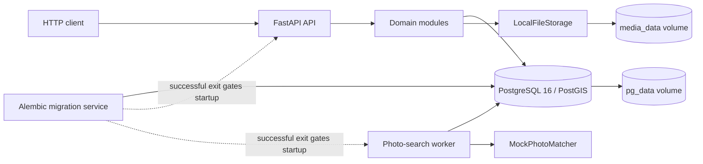

# PawLy
Backend API for lost/found animal listings, shelter adoption, and asynchronous mock photo search.

## Overview
PawLy serves people reporting or searching for animals and managers publishing shelter adoption listings.
It provides accounts, private contacts, listing photos, geographic filters, map points, and administrative moderation.
Adoption applications support approval, rejection, and withdrawal; contact requests provide a minimal owner inbox.
Clients use REST under `/api/v1`; Swagger and OpenAPI describe the HTTP contract.
There is no frontend, full chat, real image recognition, model training, embedding store, or object-storage adapter.
Photo search returns real listings in deterministic hash order; it does not measure visual similarity.
This file is the canonical technical reference and ADR log; the README is an entry point.

## Architecture



| Component | Responsibility | Technologies | Where in code |
| --- | --- | --- | --- |
| API and lifecycle | Routing, dependencies, CORS, health, engine lifecycle | FastAPI, Uvicorn, Pydantic 2 | [main](./app/main.py), [API](./app/api/) |
| Domain modules | Auth, users, listings, media, shelters, adoption/contact, search | Async services, response DTOs | [modules](./app/modules/) |
| Database | Relational state, geographic queries, durable jobs, constraints | SQLAlchemy async, asyncpg, PostgreSQL/PostGIS | [models](./app/db/models.py), [sessions](./app/db/session.py) |
| Migrations | Apply versioned schema before application startup | Alembic; frozen initial SQL | [migrations](./migrations/), [configuration](./alembic.ini) |
| Media storage | Validate keys and write/delete normalized image files | Storage Protocol, filesystem, Pillow | [storage](./app/integrations/storage/local.py), [images](./app/modules/media/images.py) |
| Search worker | Claim, execute, retry, recover leases, fence result writes | asyncio, PostgreSQL row locks, PhotoMatcher Protocol | [worker](./app/worker.py), [jobs](./app/modules/photo_search/jobs.py), [matcher](./app/integrations/cv/matcher.py) |
| Administration | Grant admin, add shelter managers, clean media | Python CLI | [CLI](./app/cli.py) |
| Deployment and checks | Build runtime/test images and isolate integration data | Docker Compose, pytest, HTTPX, Ruff | [Compose](./compose.yaml), [Dockerfile](./Dockerfile), [tests](./tests/), [scripts](./scripts/) |

### Main data flows

**Publish a listing**
1. Authenticate and create a `draft`; adoption requires shelter membership.
2. Reserve a `pending` photo slot under a listing lock, then commit before image processing.
3. Validate JPEG/PNG/WebP bytes, apply EXIF orientation, strip metadata, and encode JPEG outside the event loop.
4. Write a temporary file, fsync, atomically rename, and mark metadata `ready`; failures mark `failed` and attempt deletion.
5. Publish only with species, location, description, a ready photo, and `event_at` for lost/found. Adoption also requires a verified shelter manager.

**Approve adoption**
1. An applicant submits a pending request for an active, visible adoption listing.
2. A verified shelter manager locks the listing, then reloads and locks the application.
3. In one transaction, approve it, reject other pending requests, and resolve the listing.
4. Partial unique indexes prevent duplicate pending applications and multiple approved applications.

**Search by photo**
1. Upload a private query image, then submit its ID, `target_kind`, optional filters, and limit 1–5.
2. Validate ownership and expiry; store a queued job. An owner-scoped `Idempotency-Key` reuses the same payload or returns 409 on conflict.
3. The worker claims with `FOR UPDATE SKIP LOCKED`, increments attempts, sets a lease token/deadline, and commits.
4. SQL selects active, visible listings with ready photos and applies the supplied scope. The mock ranks unique candidates by SHA-256.
5. Finalization checks the current, unexpired lease and atomically saves results/completion. Timeouts and transient errors retry with backoff.
6. Polling rechecks listing/media visibility; an empty corpus completes successfully. Foreign resources return 404; expired owned resources return 410.

### HTTP integration
- Register with `POST /api/v1/auth/register`; login with `POST /api/v1/auth/login`. Send the returned access token as `Authorization: Bearer ...`.
- Login sets the HttpOnly `pawly_refresh` cookie on `/api/v1/auth`, with SameSite=Lax. Use `credentials: "include"` for browser cookie requests.
- Get a CSRF token from `GET /api/v1/auth/csrf`; preserve its cookie and send the JSON `csrf_token` as `X-CSRF-Token` on refresh/logout. Origin, when present, must be allowlisted.
- Photo upload uses multipart field `file`. Search creation returns 202 and a `Location` header; poll that URL with the bearer token.
- Public filters include kind/species/sex/color, timezone-aware event bounds, and a complete latitude/longitude/radius_m set; radius is at most 100 km.

## Running and development

### Requirements and startup
Run commands from the repository root. Docker Engine and Compose v2 are sufficient; the initial build needs network access.
No host Python, mandatory `.env`, manual migration, or directory preparation is required.
```sh
docker compose config --quiet
docker compose up -d --wait
docker compose logs -f api worker migrate
```
API: http://localhost:8000/api/v1. Swagger: http://localhost:8000/docs. Schema: http://localhost:8000/openapi.json.
Health: `/health/live` checks the process; `/health/ready` checks database access, revision `0001_initial`, and writable media storage.
Only the API port is published, on loopback. PostgreSQL stays inside the Compose network.

### Local tools and tests
Optional host development requires Python 3.12 and uv; dependencies are pinned in [uv.lock](./uv.lock).
```sh
uv sync --python 3.12 --frozen
uv run ruff check .
uv run ruff format --check .
uv run pytest -q
```
Without `PAWLY_INTEGRATION=1`, pytest skips integration tests. The safe integration path uses a separate project and `pawly_test` database:
```sh
docker compose -p pawly-tests --profile test run --build --rm test
docker compose -p pawly-tests --profile test down
docker compose --profile smoke run --build --rm smoke
```
The test runner applies migrations, checks schema drift, runs Ruff, then pytest. HTTPX fixtures run ASGI lifespan and verify the database name before truncation.
Smoke uses running API/worker services and leaves its generated accounts/listings behind.
Full infrastructure verification requires a POSIX shell; it uses a unique project, tests persistence, database restart recovery, and failed-migration gating:
```sh
sh scripts/verify-compose.sh
```
Its default host port is 18081, not automatically selected; choose a free `VERIFY_API_PORT`. Verification volumes remain after shutdown.
No CI configuration exists in the repository. TODO: confirm the CI provider and required checks.

### Administration, updates, and recovery
Register the target users first; set `SHELTER_ID` to an existing shelter UUID before adding a manager. No default admin is created.
```sh
docker compose exec api python -m app.cli grant-admin admin@example.com
docker compose exec api python -m app.cli add-manager "$SHELTER_ID" manager@example.com
docker compose exec api python -m app.cli cleanup-media
```
Role commands are idempotent. Cleanup handles failed/deleted media, pending uploads and orphans older than one hour, and expired query images; queued/running searches protect their query media.
After source/schema changes, rebuild and migrate before restarting:
```sh
docker compose stop api worker
docker compose build migrate api worker
docker compose run --rm migrate
docker compose up -d --wait api worker
```
Stop if migration fails. Add a migration under [versions](./migrations/versions/) and update `SCHEMA_REVISION` when changing schema.
Alembic inspects `public` and excludes PostGIS-owned `spatial_ref_sys`; review generated migrations before use.
```sh
docker compose down
```
This retains named volumes. `docker compose down -v` deletes database and photos.

For a consistent backup, block incoming traffic and stop API/worker. These binary pipelines require Bash/WSL rather than legacy PowerShell:
```sh
docker compose stop api worker
docker compose exec -T db sh -c 'pg_dump -U "$POSTGRES_USER" -d "$POSTGRES_DB" -Fc' > pawly.dump
docker compose run --rm --no-deps -T api python -c \
  "import sys,tarfile; tarfile.open(fileobj=sys.stdout.buffer,mode='w|gz').add('/data/media',arcname='.')" > media.tar.gz
docker compose up -d --wait api worker
```
Keep both archives together. Restore only a trusted backup into the intended installation; this overwrites its database. Keep traffic blocked until migrations succeed.
```sh
docker compose stop api worker
cat pawly.dump | docker compose exec -T db sh -c \
  'pg_restore -U "$POSTGRES_USER" -d "$POSTGRES_DB" --clean --if-exists --no-owner'
cat media.tar.gz | docker compose run --rm --no-deps -T api python -c \
  "import sys,tarfile; tarfile.open(fileobj=sys.stdin.buffer,mode='r|gz').extractall('/data/media',filter='data')"
docker compose run --rm migrate
docker compose up -d --wait api worker
```

### Environment variables
[Settings](./app/core/config.py) reads process variables and an optional `.env`; [Compose](./compose.yaml) uses explicit interpolation and development defaults.
A variable present only in the host `.env` does not reach a container unless Compose forwards it. Add a Compose environment override for Settings-only variables.
Examples below are non-secret values; supply credentials privately. Changing PostgreSQL initialization variables does not update an existing database role.

| Name | Purpose | Required | Example |
| --- | --- | --- | --- |
| `APP_ENV` | development, test, or production validation | No; defaults to development | `production` |
| `DEBUG` | FastAPI debug responses | Must be false in production | `false` |
| `POSTGRES_DB` | Compose database name; forwarded as DB_NAME | No | `pawly` |
| `POSTGRES_USER` | Compose database role; forwarded as DB_USER | No | `pawly` |
| `POSTGRES_PASSWORD` | Compose database credential; forwarded as DB_PASSWORD | Override development default in production | Set privately |
| `DB_HOST` | Settings database host; Compose fixes it to db | No | `db` |
| `DB_PORT` | Settings database port; Compose fixes it to 5432 | No | `5432` |
| `DB_NAME` | Settings database name; Compose uses POSTGRES_DB | No | `pawly` |
| `DB_USER` | Settings database role; Compose uses POSTGRES_USER | No | `pawly` |
| `DB_PASSWORD` | Settings database credential | Override development default in production | Set privately |
| `JWT_SECRET` | HS256 signing key; shared across API/worker restarts | Non-development value, at least 32 characters in production | Set privately |
| `JWT_ISSUER` | Settings-only required JWT issuer claim | No; default pawly | `pawly` |
| `JWT_AUDIENCE` | Settings-only required JWT audience claim | No; default pawly-api | `pawly-api` |
| `ACCESS_TTL_SECONDS` | Settings-only access token lifetime | No; default 900 | `900` |
| `REFRESH_TTL_SECONDS` | Settings-only refresh token lifetime | No; default 604800 | `604800` |
| `COOKIE_SECURE` | HTTPS-only refresh/CSRF cookies | Must be true in production | `true` |
| `CORS_ORIGINS` | JSON origin allowlist; wildcard rejected | HTTPS origins in production | `["https://pawly.example.com"]` |
| `MEDIA_ROOT` | Image directory; Compose fixes it to /data/media | No | `/data/media` |
| `CV_MODE` | Search provider selection; only mock is supported | No | `mock` |
| `SEARCH_TTL_SECONDS` | Search/query-image lifetime | No; default 86400 | `86400` |
| `WORKER_POLL_SECONDS` | Settings-only queue polling interval | No; default 1 | `1` |
| `WORKER_TIMEOUT_SECONDS` | Settings-only matcher execution timeout | No; default 30 | `30` |
| `WORKER_LEASE_SECONDS` | Settings-only lease duration; must exceed timeout | No; default 60 | `60` |
| `WORKER_MAX_ATTEMPTS` | Settings-only maximum claim attempts | No; default 3 | `3` |
| `UPLOAD_MAX_BYTES` | Settings-only upload limit; at most 10 MiB | No | `10485760` |
| `IMAGE_MAX_PIXELS` | Settings-only decoded image limit; at most 20 MP | No | `20000000` |
| `API_PORT` | Compose loopback host port | No; default 8000 | `8000` |
| `PAWLY_INTEGRATION` | Enable integration test collection | Set to 1 by test service | `1` |
| `VERIFY_API_PORT` | Host port for infrastructure verification | No; default 18081 | `18082` |

Production also rejects the development database password and JWT secret. Provide HTTPS termination externally; it is not part of Compose.

## Conventions
- Python uses `snake_case` modules/functions, `PascalCase` classes, and uppercase configuration constants.
- Business modules use `router.py`, `schemas.py`, and `service.py`; listings also use `repository.py`. Shared ORM models live in [models](./app/db/models.py).
- Routers handle HTTP/DTOs; services own authorization, state transitions, and transactions. Query helpers receive an existing session.
- Each concurrent request/job operation owns its AsyncSession. Use thread-pool helpers for blocking image/filesystem work.
- IDs are UUIDs; timestamps are timezone-aware. Locations use longitude before latitude, SRID 4326; radius queries use metres.
- Lists use `{items,next_cursor}`, descending `created_at,id`, default limit 20/max 100. Map uses bbox `west,south,east,north`, default 500/max 1000, and `truncated`.
- Ruff targets Python 3.12 and 100 columns; enabled rules are E/F/I/UP/B/ASYNC, except B008. [pyproject.toml](./pyproject.toml) defines tooling.
- Tests use `test_*.py`, pytest assertions, async fixtures, and an `integration` marker. Integration tests use PostgreSQL/PostGIS, not SQLite or mocked ORM.
- Current branch: `main`. No commits or enforced commit/branch rules exist locally. TODO: confirm commit format, branch policy, and review requirements.

## Architectural decision log
These Accepted records reconstruct implemented choices, not an undocumented alternatives review.
TODO: establish original dates and adoption order; `git log` has no commits. Bootstrap entries use descending IDs; historical chronology is unknown.
Keep numbering continuous and place future entries newest first. Do not rewrite accepted decisions: add a new ADR and mark the old one `Superseded by ADR-XXX`.
Use `Proposed`, `Accepted`, `Deprecated`, or `Superseded by ADR-XXX`. Record costly changes, not local naming/style choices.
Include each future ADR in the same PR as its code change.

### ADR-005: Access JWT and rotating refresh sessions
- Date: TODO: no commit history or recorded adoption date.
- Status: Accepted
- Context: Clients authenticate HTTP requests while refresh sessions require revocation. Current user activity and roles remain database state.
- Decision: Hash passwords with Argon2; issue HS256 access JWTs for 15 minutes and opaque refresh cookies for 7 days by default. Store only refresh hashes, rotate tokens, serialize each family, and persist family revocation before reporting reuse. Refresh/logout require a matching CSRF cookie/header and an allowed Origin when present.
- Alternatives:
  - TODO: confirm which session/token designs were evaluated and why they were rejected.
- Consequences: Refresh requires database access. Concurrent refresh calls can revoke the family; clients must serialize them. Logout revokes refresh sessions; issued access tokens remain valid until expiry unless the user becomes inactive.
- Evidence: [security](./app/core/security.py), [auth service](./app/modules/auth/service.py), [dependencies](./app/api/dependencies.py).

### ADR-004: Docker Compose with persistent local storage
- Date: TODO: no commit history or recorded adoption date.
- Status: Accepted
- Context: API, worker, migrations, and database are separate processes. Database records and image files must survive container recreation.
- Decision: Build one non-root runtime image for API/worker/migrate. Compose waits for a healthy PostgreSQL service and a successful migration before starting API/worker. Persist database and image files in named volumes; use LocalFileStorage behind a Storage Protocol.
- Alternatives:
  - TODO: confirm which deployment and storage alternatives were evaluated and why they were rejected.
- Consequences: One-host deployment is straightforward, but volume backup and media cleanup are operator responsibilities. Database/file writes need recovery because no shared transaction exists. A multi-host setup needs a different storage adapter.
- Evidence: [Dockerfile](./Dockerfile), [Compose](./compose.yaml), [local storage](./app/integrations/storage/local.py).

### ADR-003: Modular monolith with a PostgreSQL-backed worker
- Date: TODO: no commit history or recorded adoption date.
- Status: Accepted
- Context: Auth, listings, shelters, and adoption share authorization rules and relational transactions. Photo search must continue independently of an HTTP request.
- Decision: Keep domain modules in one Python application and schema. Run search as a separate process using durable photo_searches rows, short SKIP LOCKED claims, expiring leases, retries, and token-fenced finalization. Invoke a replaceable PhotoMatcher; only the deterministic mock is implemented.
- Alternatives:
  - TODO: confirm whether service separation or external brokers were evaluated and why they were rejected.
- Consequences: No broker service is required. API and worker releases remain coupled to shared schema/code; lease recovery and safe repeated execution must be maintained. Default worker concurrency is one; exactly-once execution is not guaranteed.
- Evidence: [modules](./app/modules/), [jobs](./app/modules/photo_search/jobs.py), [worker](./app/worker.py).

### ADR-002: PostgreSQL 16 with PostGIS
- Date: TODO: no commit history or recorded adoption date.
- Status: Accepted
- Context: Listings need metre-based geographic filtering alongside relational state. Adoption approvals and worker claims need transactional locking.
- Decision: Use PostgreSQL 16/PostGIS, SQLAlchemy async/asyncpg, and Alembic. Store locations as geography(Point,4326) with a GiST index; use ST_DWithin for radius queries. Protect relational invariants with foreign keys, checks, and partial unique indexes.
- Alternatives:
  - TODO: confirm which databases and geographic storage approaches were evaluated and why they were rejected.
- Consequences: Development/integration environments need PostGIS. Migrations must account for extension-owned objects. Adoption approvals and jobs rely on PostgreSQL-specific locking/index behavior.
- Evidence: [models](./app/db/models.py), [geographic queries](./app/modules/listings/repository.py), [initial migration](./migrations/versions/0001_initial.py).

### ADR-001: Python 3.12 and async FastAPI
- Date: TODO: no commit history or recorded adoption date.
- Status: Accepted
- Context: The repository exposes a typed HTTP API and a separate asynchronous worker. Request DTOs and ORM state serve different purposes.
- Decision: Use Python 3.12, FastAPI/Uvicorn, Pydantic 2, and async SQLAlchemy. Manage engine lifetime through ASGI lifespan, keep response schemas separate from ORM classes, and pin dependencies through uv.lock.
- Alternatives:
  - TODO: confirm which languages/frameworks were evaluated and why they were rejected.
- Consequences: Maintain Python 3.12 compatibility and asynchronous session discipline. Blocking operations require thread-pool execution; dependency updates require a regenerated lock and build/test checks.
- Evidence: [dependencies](./pyproject.toml), [application](./app/main.py), [session setup](./app/db/session.py).

## Known limitations and technical debt
- Mock search is plumbing only: provider `mock-v1`, `is_mock=true`, and null model version/similarity scores. No CV accuracy claim is supported.
- Images are limited to non-animated JPEG/PNG/WebP, 10 MiB, 20 MP, and five pending/ready slots per listing. No S3 adapter exists.
- Publishing requires ready photos; active edits cannot remove publication fields or the last photo. DELETE archives; resolved/archived listings cannot be republished.
- Contact requests are an inbox, not a chat. Profile contacts and query uploads are private; public access covers only active, non-hidden listings and ready photos.
- Cleanup has no scheduler. Expired search records and media tombstones remain; TODO: define retention, cleanup scheduling, and backup ownership/restore targets.
- CI, production hosting, HTTPS termination, and release policy are not configured here. TODO: confirm the intended operational setup.
- Real search remains research: define a permitted dataset, Recall@K/Precision@K evaluation, baselines, and measured thresholds before adding an encoder/embedding repository. A future HTTP encoder plus PostgreSQL/pgvector is a plan, not implemented infrastructure.
- [Existing research notes](./docs/cv-research.md) and [dog breed/color notes](./W.md) are planning inputs. TODO: reconcile their scope with the current generic animal API; breed/color inference and mandatory breed/color inputs are not implemented.

## Glossary
- **Refresh family:** an initial refresh session and its rotated successors; replay revokes the family.
- **Lease/fencing token:** a job claim deadline and unique token that prevent an expired attempt from replacing a newer attempt's results.
- **Idempotency key:** an owner-scoped request key that reuses the same search for an identical normalized payload.
- **Tombstone:** retained metadata for an expired/deleted resource after its usable lifetime ends.
- **Geography:** PostGIS's geodetic type, used here for radius distances in metres.
